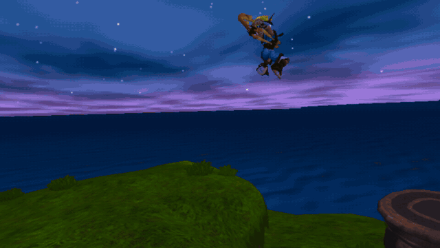

# Dark Eco — Jak trilogy on Apple platforms

**A simple launcher for playing Jak on your Apple devices.**

Once Dark Eco is installed, **add your own game files, choose a game, and
play**. Game import, controls, graphics, and saves are managed inside the app;
optional iCloud sync carries saves and settings between your Apple devices.
Everyday setup and play happen in the app, without terminal commands.

Dark Eco is built for **iPhone, iPad, and Apple Vision Pro**, with an
**experimental Apple silicon Mac version** as well.

| Device | Controls and availability |
| --- | --- |
| **iPhone and iPad** | **Touch controls or a gamepad.** |
| **Mac (Apple silicon) — experimental** | Earlier Jak 1 data import and title-screen boot demonstrated; full gameplay is not yet validated. |
| **Apple Vision Pro** | **Gamepad or PSVR2 Sense controllers.** Sense motion gestures are currently a Jak 1 feature. |

Vision Pro also has an experimental **immersive third-person mode**, with Jak
visible in the world around you. See [game support](#game-support) below for
what is available and what remains unfinished.

OpenGOAL provides the reconstructed game code, compiler, and runtime foundation.
Dark Eco adds native Apple ports and Metal graphics, a Swift/SwiftUI launcher
and game library, on-device file import, iCloud sync, Apple-device controls,
and Vision Pro presentation.

Bring compatible game data from your own legally obtained PlayStation 2 copy;
Dark Eco does not include or download the games. Game code is compiled ahead
of time into the signed app, with no PS2 emulation, JIT, or jailbreak requirement.
This is the **Dark Eco app repository**. The Xcode project and scheme retain the
internal name **GOALPad**. Its OpenGOAL engine dependency lives in
[`jak-pad`](https://github.com/zschwendi/jak-pad) and is pulled in automatically
when cloning with submodules; players start here.

[Play](#install-and-play) · [Controls](#controls) · [Build from source](#build-from-source) · [Contributors and agents](#contributors-and-agents)

## Game support

The progress below does not certify Mac gameplay. Mac shares application and
runtime code with the other platforms, but current feature parity and full
Mac gameplay have not been tested.

| Game | Ordinary windowed play | Apple Vision Pro immersion |
| --- | --- | --- |
| **Jak and Daxter: The Precursor Legacy** | Playable; the established Dark Eco baseline. A full-game completion pass is not certified. | **Mostly finished, but still incomplete.** Experimental third-person view with Jak visible. Known issues remain with sky coverage, stereo effects, and HUD/interaction prompts. |
| **Jak II** | **Almost finished, but still incomplete.** Performance and a Dark Jak crash near the early Kor/child encounter are being fixed; broader gameplay and device verification continue. | **Not started.** Planned after the remaining Jak 1 immersive issues are resolved. |
| **Jak 3** | **Planned; work has not started.** | **Planned; work has not started.** |

Immersive availability depends on the build: it is developed in a separate
experimental lane, so a windowed build does not automatically include it.
Jak II and Jak 3 immersion are planned to use a normal DualSense controller.

For development evidence and open work, see [HANDOFF](HANDOFF.md) and
[ROADMAP](ROADMAP.md). The known issues above remain the player-facing status.

## See Dark Eco



Zach's own Vision Pro recording of Dark Eco's experimental Jak 1 immersive
mode. This is an in-development build; the remaining issues are listed above.

## Install and play

### 1. Get the app for your Apple device

Check the [Dark Eco releases](https://github.com/zschwendi/dark-eco/releases)
for an available build and follow that release's installation and signing
instructions. Use the package for your device: iPhone/iPad, Mac, or Vision Pro.
A signed package is not necessarily provisioned for every device.

Distribution is through GitHub source and release artifacts, **not the App
Store or TestFlight**. If no suitable package is published, use the
[source-build steps below](#build-from-source). Current project deployment
targets require iOS/iPadOS 26.5, macOS 26.5, or visionOS 26.5 or newer.

### 2. Add your game data

1. Open Dark Eco and choose **Jak and Daxter** or **Jak II** in the **Library**.
2. If **Set Up Game Data** appears, choose **Continue**.
3. Select **Choose game data…** and choose a supported source for that game:
   - A supported **ISO**, or a **ZIP/7z containing exactly one ISO**, when disc
     preparation is enabled in that build.
   - A compatible **prepared game data folder** containing OpenGOAL's `iso/`
     and `fr3/` output. Use data for the selected game.
4. Keep Dark Eco open and in the foreground while it prepares and imports the
   data. The setup screen reports progress and explains unsupported sources.
5. When setup finishes, choose **Play Now**.

On-device disc preparation currently accepts **Jak 1 SCUS-97124 (NTSC v1,
Black Label)** and **Jak II SCUS-97265 (NTSC-U v2)**. Other disc revisions may
be rejected; the prepared-folder path remains an alternative for compatible
data.

The setup screen is the authority for the formats supported by your particular
build. If a file is dimmed in the picker, check that you selected the intended
game and that the build supports that input. A locally downloaded file can
still be an unsupported format or disc revision.

Keep Dark Eco's installed game-data copy on your device. Once setup succeeds,
the app no longer needs the original import source. No game data is fetched
from the internet or supplied with this repository.

### 3. Connect your controls

- **iPhone / iPad:** use the on-screen touch controls or a compatible game controller.
- **Mac (experimental):** a complete gameplay/control pass remains unvalidated.
- **Apple Vision Pro:** use a compatible game controller. A normal DualSense
  is the intended controller for future Jak II and Jak 3 immersive play.
- **Jak 1 experimental Sense controls:** supported builds can use PSVR2 Sense
  gestures for punch, spin, and jump. Gesture support is a Jak 1 experiment;
  it is not a requirement for ordinary play.

## Controls

The original game menus explain the normal buttons. On a PlayStation-layout
controller, Cross jumps, Square punches, and Circle spins in Jak 1.

In Jak 1 builds with Sense motion enabled, either-hand forward jabs punch,
side-to-side shakes spin, and raising both controllers together jumps; repeat
the jump gesture for a double jump. Normal buttons remain available if you
prefer them. Availability and gesture tuning depend on the build.

## Saves

Save and load through the game's own menus. Dark Eco keeps each game's saves
separate, using OpenGOAL-compatible memory-card files.

Settings provides **Import Saves** and **Export Saves**. Optional **Sync Saves**
in Settings' iCloud section can synchronize between your Apple devices; gameplay
uses local saves and works offline. Export a backup before replacing an installation or changing
signing identities. An app update should be installed in place, without first
deleting the existing app and its data.

## Build from source

Use an **Apple silicon Mac**, Xcode with the required Apple SDKs, and the
[build prerequisites](docs/BUILDING.md#requirements). These instructions build
Dark Eco for Apple devices; upstream PC launcher instructions are not the app
setup path.

```sh
git clone --branch v2.0 --recurse-submodules https://github.com/zschwendi/dark-eco.git dark-eco
cd dark-eco
```

The OpenGOAL submodule is pinned by this repository. Preserve that pin rather
than substituting upstream's current branch. For an existing clean checkout:

```sh
git submodule sync -- OpenGOAL
git submodule update --init --recursive
```

Prepare both games' public source packs and generated code before opening
Xcode. These steps compile open-source code, not retail game assets. Run them
sequentially, using the same host build directory:

```sh
Scripts/prepare-jak1-source-object-pack.sh
Scripts/prepare-jak2-source-object-pack.sh
Scripts/generate-jak1-aot.sh "$PWD/OpenGOAL/build/Release/bin"
Scripts/generate-jak2-aot.sh "$PWD/OpenGOAL/build/Release/bin"
open GOALPad.xcodeproj
```

Choose the **GOALPad** scheme, select your Apple destination, and configure your
own signing team, bundle identifiers, and iCloud capabilities when installing
on hardware. The embedded
**GOALPadJak2Runtime** framework is part of Dark Eco, not a separate app.
See [Building](docs/BUILDING.md) for detailed commands, signing requirements,
and platform validation notes. Do not use the retired standalone Jak II app
or old App Store/reviewer-launcher instructions.

## Contributors and agents

Start here before changing anything:

1. Read [AGENTS.md](AGENTS.md) and the authoritative [Project Overview](docs/PROJECT_OVERVIEW.md).
2. Read the top of [HANDOFF.md](HANDOFF.md) for the latest source/build state,
   then [ROADMAP.md](ROADMAP.md) for the current priorities.
3. Inspect the parent and nested OpenGOAL Git state. Preserve dirty work,
   saves, user game data, and the distinction between the windowed and
   experimental immersive lanes.
4. Work on the smallest scoped change. Follow the current task's device
   authorization and run relevant checks; a simulator pass is not physical-device acceptance.
5. Record exact commands, results, remaining issues, and the next step in the handoff.

The unified product branch is `v2.0`. Runtime changes belong in the pinned
[OpenGOAL fork](https://github.com/zschwendi/jak-pad); app/lifecycle/import UI
changes belong here. Preserve per-game data and save isolation. Do not begin
Jak II immersion until the remaining Jak 1 immersive blockers are resolved.

| Location | Purpose |
| --- | --- |
| `GOALPad/` | SwiftUI app, settings, imports, saves, Apple hosts, native bridge |
| `GOALPad.xcodeproj/` | Shared Apple application project |
| `OpenGOAL/` | Pinned engine fork: runtime, compiler, GOAL source, Metal renderer |
| `Scripts/` | Code generation, packaging, and focused checks |
| `docs/` | Architecture, build instructions, and validation reports |
| `tests/native/` | Native test harnesses |

Do not commit disc images, extracted retail data, saves, signing material, or secrets.

## Credits

Dark Eco is by Zach Schwendiman / Zephyr Studios. It is built on the
[OpenGOAL team's work](https://github.com/open-goal/jak-project): their GOAL
language tools, reconstructed game code, runtime, and data formats make this
port possible. Dark Eco adds the Apple app, native ARM64 ahead-of-time path,
and Metal/Apple-platform integration.

This is an unofficial community project, unaffiliated with Sony Interactive
Entertainment, Naughty Dog, or the OpenGOAL team.
