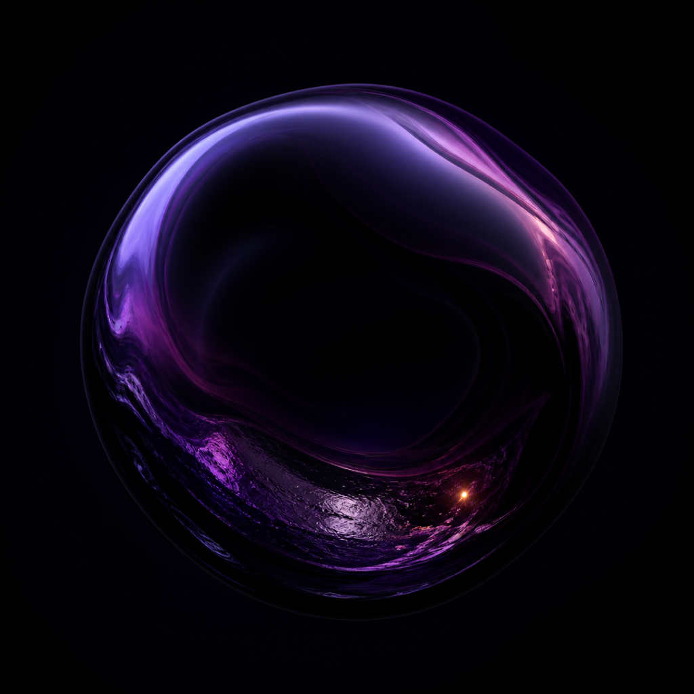
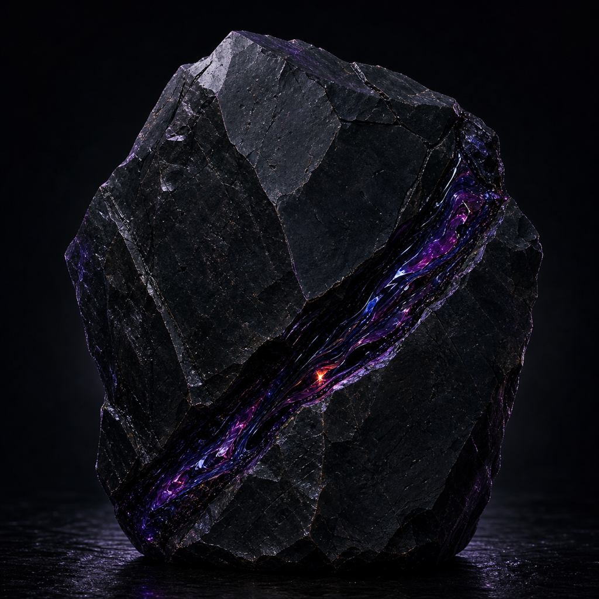
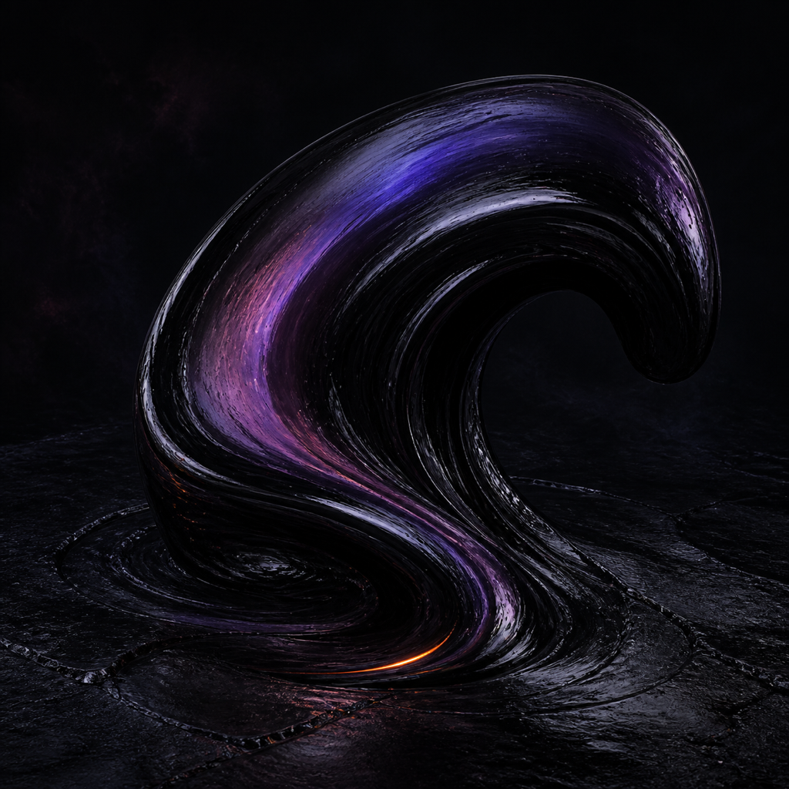

# Eco Pro dark-sheen icon concepts

Exploratory only. These files do not replace the active AppIcon. Each candidate is an original, opaque, full-bleed 1024 × 1024 PNG generated with built-in ImageGen and normalized to the required dimensions.

The exact prompts below retain the working name **Eco** used when the images
were generated. The artwork contains no text and remains applicable to the
current public name **Eco Pro**.

| Void Lens | Fault Stone | Abyss Fold |
| --- | --- | --- |
|  |  |  |
| Smooth liquid-mineral object; quiet and iconic. | Fractured monolith; the most mineral and ancient. | Heavy liquid wave; the most kinetic and organic. |

The family thread is oily black-violet material, indigo-to-magenta interference sheen, near-black negative space, and one restrained hot-orange reflection. The three silhouettes deliberately explore object, stone, and flow without using game art, franchise symbols, glyphs, characters, or text.

## Exact prompts

<details>
<summary>Void Lens</summary>

```text
Use case: logo-brand
Asset type: 1024x1024 iPadOS app icon candidate for the public product Eco
Primary request: Create an original premium abstract icon called “Void Lens”: a single large smooth black-violet mineral droplet/lens, nearly circular but organically asymmetric, emerging from a deep near-black field. Its surface carries an oily liquid sheen that shifts only through indigo, ultraviolet purple, and restrained magenta, like dense luminous material under dark glass. Add a barely perceptible inner metallic depth around one lower arc and exactly one tiny hot-orange reflected glint, no larger than a spark.
Style/medium: sophisticated dimensional material study, polished native-platform app icon, restrained cinematic 3D render; mysterious rather than fantasy
Composition/framing: square 1:1, full-bleed opaque artwork; one unmistakable centered silhouette occupying about 72 percent of the canvas; simple enough to read at 32px; visual weight centered; no outer frame and no rendered rounded corners
Lighting/mood: very dark, controlled, premium, uncanny; soft grazing light reveals the oil-slick violet sheen without turning neon
Color palette: oily black, black-violet, deep indigo, restrained magenta, one minute hot-orange glint
Materials/textures: dense glossy liquid-mineral surface, subtle hammered ancient-metal depth only as an abstract material quality, no engravings
Constraints: entirely original; no copied franchise symbols; no official glyphs, runes, logos, letters, numbers, names, text, character silhouettes, creatures, faces, recognizable game artwork, or watermark; no Eco wordmark; no leaf; no recycling symbol; no device mockup; no border; no transparent corners; no bright green; no blue portal; do not resemble an eye; do not resemble a known game pickup or emblem
Output intent: a complete opaque 1024x1024 app-icon source image with sharp clean edges and no baked corner radius
```

</details>

<details>
<summary>Fault Stone</summary>

```text
Use case: logo-brand
Asset type: 1024x1024 iPadOS app icon candidate for the public product Eco
Primary request: Create an original premium abstract icon called “Fault Stone”: one massive irregular black mineral monolith seen almost front-on, a compact faceted silhouette like a naturally fractured river stone rather than a letter or emblem. A single wide diagonal fault cuts through the stone without separating it. Inside that fault, dense oily material catches restrained indigo and magenta interference colors; the rest remains near-black with subtle violet edge sheen. Set exactly one tiny hot-orange glint deep inside the fault, as a reflected ember rather than a glowing symbol.
Style/medium: sophisticated dimensional material study, polished native-platform app icon, restrained cinematic 3D render; ancient engineered depth suggested only by material and age, not by glyphs
Composition/framing: square 1:1, full-bleed opaque artwork; one bold centered monolith occupying about 70 percent of the canvas; compact asymmetrical silhouette that reads instantly at 32px; no outer frame and no rendered rounded corners
Lighting/mood: very dark, controlled, premium, quiet, mysterious; grazing light reveals layered mineral planes without bright neon
Color palette: oily black, black-violet, deep indigo, restrained magenta, one minute hot-orange glint
Materials/textures: dense obsidian-like mineral, worn dark metal undertone, one glossy liquid fault, subtle micro-pitting; no engraved decoration
Constraints: entirely original; no copied franchise symbols; no official glyphs, runes, logos, letters, numbers, names, text, character silhouettes, creatures, faces, recognizable game artwork, or watermark; no Eco wordmark; no leaf; no recycling symbol; no device mockup; no border; no transparent corners; no bright green; no blue portal; no circular sigil; no crown; no sword; no known game pickup or emblem
Output intent: a complete opaque 1024x1024 app-icon source image with sharp clean edges and no baked corner radius
```

</details>

<details>
<summary>Abyss Fold</summary>

```text
Use case: logo-brand
Asset type: 1024x1024 iPadOS app icon candidate for the public product Eco
Primary request: Create an original premium abstract icon called “Abyss Fold”: one thick continuous ribbon of dense black liquid-mineral rising from and folding back into a dark surface, forming a compact asymmetric hooked wave with a broad simple silhouette. The ribbon is not a letter, rune, spiral logo, creature, or portal. Its curved face carries an oily interference sheen through black-violet, deep indigo, and restrained magenta. Add exactly one fine hot-orange glint along the lowest fold, like a tiny reflection caught in old metal.
Style/medium: sophisticated dimensional material study, polished native-platform app icon, restrained cinematic 3D render; fluid but weighty, premium and mysterious
Composition/framing: square 1:1, full-bleed opaque artwork; one bold central liquid fold occupying about 75 percent of the canvas; very clear silhouette at 32px; asymmetrical motion from lower left toward upper right; no outer frame and no rendered rounded corners
Lighting/mood: very dark, controlled, premium, uncanny; narrow grazing highlights, deep shadow, no bright glow
Color palette: oily black, black-violet, deep indigo, restrained magenta, one minute hot-orange glint
Materials/textures: viscous glossy mineral liquid with a hint of weathered dark-metal grain at the base; no engraved decoration
Constraints: entirely original; no copied franchise symbols; no official glyphs, runes, logos, letters, numbers, names, text, character silhouettes, creatures, faces, recognizable game artwork, or watermark; no Eco wordmark; no leaf; no recycling symbol; no device mockup; no border; no transparent corners; no bright green; no blue portal; no circular sigil; no yin-yang; no eye; no flame; no tentacle; no known game pickup or emblem
Output intent: a complete opaque 1024x1024 app-icon source image with sharp clean edges and no baked corner radius
```

</details>
